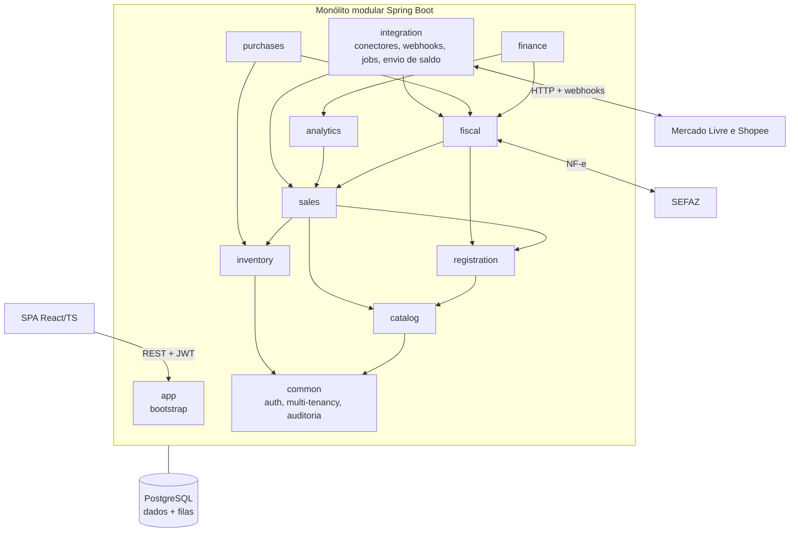
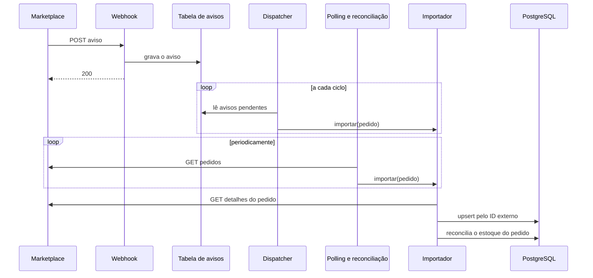
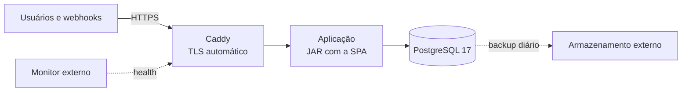

# ERP Multicanal para E-commerce

ERP em produção que centraliza a operação de um e-commerce multicanal: catálogo, estoque, compras, vendas, fiscal e financeiro. Pedidos de marketplaces e vendas B2B passam pelo mesmo sistema e pelo mesmo estoque.

> **Observação sobre este repositório:** o código-fonte é **privado** por conter regras de negócio de um cliente real. Este documento descreve a **arquitetura e as decisões técnicas** de forma genérica, sem expor dados, credenciais ou regras proprietárias. Ver a [nota final](#12-sobre-o-código-fonte).

---

## 1. Visão geral

Um e-commerce que vende em vários canais tem **um único estoque físico abastecendo todos eles**. Sem um sistema central, a operação vira um conjunto de painéis e planilhas, e o saldo real deixa de ser conhecido.

O sistema concentra:

- **Catálogo** em três níveis (Categoria → Produto → SKU), com variações, fotos e **kits** (um anúncio que vende vários SKUs).
- **Estoque único** por SKU, controlado por um livro de movimentações e compartilhado entre os canais.
- **Integração com Mercado Livre e Shopee:** pedidos, status de envio, repasse, perguntas, etiquetas e envio de saldo para os anúncios.
- **Compras:** importação do XML da nota de entrada, conversão de unidade por fornecedor e estorno de entrada.
- **Vendas B2B:** pedido manual, condição de pagamento, comissão de representante e **emissão própria de NF-e**.
- **Expedição e pós-venda:** lista de separação, etiquetas e devolução de cliente.
- **Financeiro:** contas a pagar e a receber, boletos com remessa CNAB 240, fluxo de caixa, DRE, repasse de marketplace e fechamento fiscal para o contador.

### Porte

Números medidos no código em novembro de 2026:

| Métrica | Valor |
|---|--:|
| Módulos Maven | 11 + frontend |
| Java em `src/main` | ~37,6 mil linhas |
| Java em `src/test` | ~37,4 mil linhas |
| Testes automatizados | 1.528 |
| Endpoints REST | 263, em 57 controllers |
| Migrações de banco | 72 |
| Frontend (TypeScript) | ~26,8 mil linhas, 73 páginas |
| Commits | mais de 1.100 desde março de 2026 |

---

## 2. Stack

| Tecnologia | Versão | Para que é usada |
|---|---|---|
| Java | 21 | Linguagem base |
| Spring Boot | 3.3.6 | Web, Data JPA, Security, Validation, agendamento |
| PostgreSQL | 17 | Banco relacional único, também usado como fila de trabalho |
| Flyway | gerenciado pelo Spring Boot | Migrações de schema versionadas |
| Hibernate ORM | via Spring Data JPA | Persistência e **multi-tenancy por discriminador** (`@TenantId`) |
| jjwt | 0.12.6 | Access token e refresh token |
| Bibliotecas `nfe` e `java-danfe` | — | Comunicação com a SEFAZ e geração do DANFE |
| Apache POI | — | Planilhas do fechamento fiscal |
| React + TypeScript + Vite + Ant Design | 18 / 5 / 6 / 6 | Frontend (SPA), com TanStack Query e Recharts |
| Docker Compose + Caddy | Caddy 2 | Produção em contêineres com TLS automático |
| SonarQube | Community | Análise estática em ambiente local |

Dependências **declaradas, mas não usadas por nenhuma classe**: Resilience4j, Testcontainers e WireMock. Ver a [seção 9](#9-estratégia-de-testes).

---

## 3. Arquitetura

O sistema é um **monólito modular**: todos os módulos rodam no mesmo processo Spring Boot, com fronteiras de dependência definidas no Maven. Cada módulo segue as camadas `controller` → `service` → `repository` → entidades.

Os módulos conversam de três formas:

1. **Chamada direta**, sempre no sentido permitido pelo Maven.
2. **Ports e adapters**, quando o sentido precisa se inverter: o port fica no módulo consumidor e o adapter no provedor.
3. **Eventos do Spring dentro do processo** (`@TransactionalEventListener`) e **filas em tabelas do PostgreSQL**, quando o trabalho deve acontecer depois do commit.



O diagrama mostra as dependências principais; todos os módulos também dependem de `common`.

| Módulo | ~Linhas (main) | Responsabilidade |
|---|--:|---|
| `integration` | 10.000 | Conectores, webhooks, jobs de polling e reconciliação, envio de saldo, etiquetas |
| `fiscal` | 6.700 | Emissão, cancelamento e recuperação de NF-e, DANFE, tributos aproximados, vínculo de notas, fechamento |
| `sales` | 5.900 | Pedidos, importação de marketplace, estoque por pedido, separação, devolução, comissão |
| `finance` | 3.900 | Contas a pagar e a receber, boletos, remessa CNAB 240, despesas, fluxo de caixa, DRE |
| `catalog` | 2.600 | Categoria, Produto, SKU, vínculos com anúncios e kits |
| `purchases` | 2.600 | Compras, XML de entrada, conversão de unidade, estorno |
| `registration` | 2.100 | Clientes e fornecedores, com consulta cadastral |
| `common` | 1.800 | Autenticação, multi-tenancy, criptografia, auditoria |
| `analytics` | 1.200 | Dashboards de vendas e margem |
| `inventory` | 800 | Posições e movimentos de estoque, fila de saldo |
| `app` | 130 | Bootstrap, migrações e manual do usuário |

---

## 4. Decisões técnicas e trade-offs

### 4.1. Monólito modular em vez de microserviços

- **Problema:** vários subdomínios precisam de fronteiras claras, mas a operação é pequena e roda em uma VPS de 4 GB.
- **Escolha:** módulos Maven com dependências direcionadas, em um único processo.
- **Por quê:** separa responsabilidades sem o custo de rede, orquestração e transações distribuídas.
- **Custo:** um deploy único, em que uma falha grave derruba tudo. A escala é vertical, e algumas regras de negócio cruzam módulos.

### 4.2. Remoção do Transactional Outbox e do RabbitMQ

A primeira versão usava outbox transacional e RabbitMQ entre os módulos. **Essa decisão foi revertida** em setembro de 2026, antes do início da operação com pedidos reais.

- **O que uma auditoria encontrou:** o único produtor real do outbox era o envio de saldo. Não existia nenhum `@RabbitListener`, e as filas configuradas não tinham uso.
- **O que o broker custava:** um contêiner de até 320 MB em uma VPS de 4 GB, dependência na subida da aplicação e um health check que caía junto com ele.
- **O problema de fundo:** o evento levava o saldo do momento, e uma entrega atrasada podia publicar um número velho. A semântica de fila de mensagens não combinava com o problema, que é sincronizar **estado**.
- **Escolha:** remover o outbox e o broker. Quando o envio de saldo foi para o PostgreSQL ([4.3](#43-envio-de-saldo-por-reconciliação-com-fila-no-postgresql)), nada mais precisava deles.
- **Custo:** se houver várias instâncias, ou volume muito maior, a decisão precisa ser revista.

### 4.3. Envio de saldo por reconciliação, com fila no PostgreSQL

- **Problema:** cada mudança de estoque precisa chegar aos anúncios. As chamadas podem falhar, atrasar ou repetir, e o canal pode ficar fora do ar.
- **Escolha:** uma tabela de pendências com **uma linha por SKU desatualizado**, gravada na mesma transação do movimento de estoque. A fila guarda **qual SKU mudou, nunca o número**.
- **Como funciona:** o worker reivindica linhas com `FOR UPDATE SKIP LOCKED` e um lease, lê o saldo atual, calcula o disponível de cada anúncio e envia. A linha é apagada no sucesso e, na falha, volta com backoff. Um job de reenvio periódico funciona como rede de segurança.
- **Kits:** o disponível do anúncio é o menor `floor(disponível / quantidade)` entre os componentes.
- **Por quê:** repetir ou atrasar não publica número velho, e a fila não cresce, porque guarda estado em vez de histórico.
- **Custo:** a latência é a de um ciclo do worker, e o desenho parte da premissa de uma instância da aplicação.

### 4.4. Multi-tenancy por discriminador

- **Problema:** atender mais de um cliente no mesmo deploy, sem multiplicar a infraestrutura. Hoje há um tenant em produção.
- **Escolha:** coluna `tenant_id` com `@TenantId` do Hibernate, que filtra as queries automaticamente. O tenant vem do JWT.
- **Custo:** o isolamento é lógico, não físico. O filtro **não alcança SQL nativo**, então essas queries levam o tenant explícito. Jobs fora do fluxo HTTP também precisam definir o tenant.

### 4.5. Estoque por livro de movimentos, reconciliação e lock pessimista

- **Problema:** um pedido de marketplace não percorre uma máquina de estados. Ele pode ser importado já enviado, pular etapas, ser cancelado depois de entregue, e o polling repete o mesmo status. Um listener por transição viraria uma malha de casos especiais.
- **Escolha:** um único serviço move estoque por causa de pedido, por **reconciliação**. Ele deriva o estágio atual do saldo líquido dos movimentos, compara com o estágio desejado pelo status e aplica só a diferença. Ver a [seção 6](#6-controle-de-estoque).
- **Concorrência:** lock pessimista na linha do pedido e na posição de cada SKU, sempre em **ordem alfabética de SKU** para evitar deadlock.
- **Custo:** transações que tocam estoque precisam ser curtas, e pedidos que disputam o mesmo SKU são serializados.

### 4.6. Ingestão redundante de pedidos

- **Problema:** webhooks atrasam, falham ou nem chegam, e perder um pedido é inaceitável.
- **Escolha:** o webhook é só um **gatilho**, e há redes de segurança independentes. Ver a [seção 5](#5-pipeline-de-integração-com-marketplaces).
- **Custo:** vários caminhos para a mesma coisa, o que exige idempotência em todos eles.

### 4.7. Emissão de NF-e tratando a SEFAZ como fonte da verdade

- **Problema:** a SEFAZ pode autorizar a nota e a resposta se perder. A transação local desfaz a gravação e devolve o número, enquanto a nota já existe para o fisco.
- **Escolha:** a transmissão fica atrás de ports, com adapters para a biblioteca de NF-e, e existe um fluxo de **recuperação** que consulta a SEFAZ pela chave e registra no ERP a nota autorizada.
- **Origem:** esse fluxo surgiu de um caso real em produção.
- **Custo:** a nota recuperada só tem o protocolo, sem o XML, então fica sem DANFE. Ela volta a ocupar o número e pode ser cancelada.

### 4.8. Autenticação com access token em memória e refresh em cookie

- **Escolha:** access token JWT curto, guardado **só em memória** no frontend, e refresh token em cookie `HttpOnly`, `SameSite` e `Secure`, persistido no banco.
- **Por quê:** nenhum token fica em `localStorage`, e o refresh pode ser rotacionado e revogado no servidor.
- **Custo:** o refresh reintroduz estado no servidor, e a renovação no cliente precisa ser single-flight. Sem isso, requisições paralelas disputam um token que a rotação já revogou.

---

## 5. Pipeline de integração com marketplaces

Os pedidos entram por quatro caminhos:

| Caminho | Quando roda | Papel |
|---|---|---|
| **Webhook** | A cada aviso do canal | Baixa latência no caso normal |
| **Polling de pedidos** | A cada 5 minutos | Descobre pedidos que o webhook não trouxe |
| **Reconciliação** | A cada 10 minutos | Atualiza o status dos pedidos em aberto |
| **Catch-up** | Na subida da aplicação | Cobre o período em que o sistema esteve fora do ar |

O aviso é gravado em uma tabela e processado depois por um dispatcher agendado. Assim, a resposta ao canal é rápida e um aviso não se perde se o processamento falhar. Os dados do pedido sempre vêm da API do canal, e o ID externo garante que o mesmo pedido não seja importado duas vezes.



Outros pontos do pipeline:

- **Item sem vínculo:** o pedido entra e aguarda o vínculo do anúncio com o SKU. Depois do vínculo, os pedidos pendentes são atualizados.
- **Pacote do Mercado Livre:** um carrinho com vários itens vira um único pedido.
- **Corte de estoque:** só pedidos posteriores à data da carga de saldo movem estoque. Assim, importar vendas antigas não desconta o saldo de novo.
- **Dados financeiros:** taxas e frete de cada venda são sincronizados, e o líquido calculado foi conferido contra o valor real em uma amostra de pedidos.
- **Saúde das conexões:** o health check mostra o estado dos tokens de cada canal, um problema que não dá sinal nenhum na tela até os pedidos pararem de entrar.

Um conector para o Magalu chegou a ser escrito, mas a integração foi encerrada por uma restrição contratual da conta. O código está desligado por configuração.

---

## 6. Controle de estoque

Cada pedido tem um estágio de estoque, **derivado do livro de movimentos** e nunca gravado como um campo separado:

| Status do pedido | Estágio desejado | Efeito |
|---|---|---|
| Rascunho ou cancelado | Nenhum | Libera a reserva ou devolve o que foi baixado |
| Confirmado ou faturado | Reservado | Reserva o saldo |
| Enviado ou entregue | Baixado | Baixa o saldo e libera a reserva |

Como o estágio vem do saldo líquido, repetir o mesmo status não faz nada, e compensar um movimento devolve o pedido ao estado anterior. Kits movem cada SKU componente. Pedido com item sem vínculo não move estoque, porque o sistema ainda não sabe qual SKU foi vendido.

**A lição que levou a esse desenho:** a primeira versão baixava estoque em um método chamado apenas por um botão da tela, enquanto o pedido de marketplace recebia o status direto do canal. Cada peça estava correta e testada isoladamente, mas a ligação entre elas não existia. O defeito apareceu ao olhar dados reais: pedidos enviados sem nenhum movimento de saída. Isso motivou uma **auditoria por fluxo de ponta a ponta**, antes de entrar em operação, que encontrou outros defeitos da mesma classe.

---

## 7. Módulo financeiro e fiscal

- **Contas a pagar**, a partir de notas de entrada e lançamentos manuais, e despesas recorrentes materializadas por um job.
- **Contas a receber**, com parcelas geradas a partir da condição de pagamento do pedido.
- **Boletos**, com remessa **CNAB 240** gerada campo a campo no layout do banco e registro de remessas recusadas.
- **Fluxo de caixa e DRE**, consolidando entradas e saídas do período.
- **Repasse de marketplace**, com o líquido da venda depois de taxas e frete.
- **NF-e própria**, com emissão, cancelamento, recuperação, parcelas, frete, transporte, tributos aproximados por NCM e DANFE com modelo próprio.
- **Correção e reemissão:** pedido sem nota válida pode ter os itens corrigidos antes de emitir de novo.
- **Notas de marketplace**, importadas e vinculadas aos pedidos.
- **Fechamento fiscal**, em planilha para o contador.

> As regras fiscais específicas (tributos, CFOPs, cenários) não são detalhadas aqui por serem particulares do cliente.

---

## 8. Segurança

O sistema passou por uma auditoria interna seguida de cinco fases de correção e testes manuais antes de entrar em operação.

- **Autenticação:** JWT curto, refresh com rotação e revogação no logout, e limite de tentativas de login.
- **Autorização:** papéis com `@PreAuthorize` nos endpoints sensíveis, e actuator público restrito ao health.
- **Isolamento de tenant:** o tenant vem do token validado, nunca de um cabeçalho enviado pelo cliente.
- **Webhooks:** endpoints públicos limitados ao necessário, com validação de tópico ou assinatura conforme o canal.
- **Segredos em repouso:** criptografia AES-GCM, usada por exemplo na senha do certificado A1.
- **Cabeçalhos e CORS:** CSP, HSTS, `X-Frame-Options`, `Referrer-Policy` e lista de origens permitidas.
- **Auditoria:** log estruturado de login, renovação, logout e acessos negados, com e-mail mascarado.
- **Rede:** só o proxy reverso fica exposto, e a aplicação não publica porta.
- **Dependências:** `npm audit` no frontend e OWASP dependency-check em um perfil Maven opcional, fora do build padrão.

> Esta seção descreve a **abordagem**. Segredos, tempos de expiração e chaves não são expostos.

---

## 9. Estratégia de testes

A última execução completa teve **1.528 testes, 0 falhas e 1 ignorado**, em 275 classes.

| Tipo | Classes |
|---|--:|
| Unitários com Mockito | 62 |
| `@SpringBootTest`, com PostgreSQL real | 51 |
| `@WebMvcTest` | 9 |
| `@DataJpaTest` | 7 |
| Unitários puros, sem dublês | os demais |

**O que foi priorizado:** regras de negócio dos serviços, importação de pedidos, ciclo de vida fiscal, estoque, formato do arquivo CNAB e autenticação. Os testes `@DataJpaTest` rodam o SQL real no PostgreSQL porque parte da lógica está em SQL nativo.

**A suíte não basta sozinha:** o principal defeito encontrado antes da operação passou por todos os testes ([seção 6](#6-controle-de-estoque)). Por isso as entregas também são conferidas em homologação fiscal, no navegador e contra os dados de produção, em modo somente leitura.

**Limitações conhecidas:**

- Os testes de integração exigem um PostgreSQL provisionado, então a suíte não é auto-contida.
- **Não há CI:** a suíte roda no script de release, na máquina de desenvolvimento, e bloqueia a publicação se falhar.
- **Testcontainers, WireMock e Resilience4j constam no `pom.xml`, mas nenhuma classe os usa.** Seriam a evolução natural para tornar a suíte auto-contida, simular as APIs dos canais e dar resiliência às chamadas externas.
- O frontend não tem testes automatizados, e o build com TypeScript é a única verificação automática.

---

## 10. Deploy e operação

A produção são três contêineres em uma VPS de 4 GB, com limites de memória definidos a partir de medições:



- **Publicar:** o script de release recusa alterações não commitadas, roda a suíte, gera a imagem Docker e a publica em um registro de contêineres.
- **Atualizar:** o script do servidor faz um backup, sobe a nova versão, aguarda o health check e **reverte sozinho se ela não ficar saudável**. O downtime é de cerca de 40 segundos, e as migrações rodam na subida.
- **Backup:** dump diário enviado para armazenamento externo, com o upload conferido e um script de teste de restauração.
- **Monitoramento:** monitor externo sobre o health check, rotação de logs e estado das conexões de marketplace no health detalhado.

### Execução local

O código é privado, então isto serve só como referência do processo de desenvolvimento:

```bash
# pré-requisito: PostgreSQL local
./mvnw spring-boot:run -pl <app>   # backend em :8080; o Flyway aplica as migrações
cd <frontend> && npm run dev       # frontend em :3000, com proxy para o backend
```

As integrações exigem credenciais OAuth próprias. Sem elas, o que não depende de canal externo funciona normalmente.

---

## 11. Status do projeto

**Em produção** desde agosto de 2026, com pedidos reais desde outubro de 2026.

| Área | Situação |
|---|---|
| Importação de pedidos do Mercado Livre e da Shopee | Em uso |
| Estoque, compras, catálogo e separação | Em uso |
| Emissão de NF-e própria | Em uso, com notas reais autorizadas |
| Financeiro e fechamento fiscal | Implantados |
| Boletos e remessa CNAB 240 | Implementados e em produção; a primeira remessa real ainda não foi enviada ao banco |
| Envio de saldo e respostas aos canais | Implementados, em **dry-run**: o sistema calcula e registra, mas ainda não grava nos canais |
| Magalu | Encerrado |

Sair do dry-run é, de propósito, a última etapa: só depois que os vínculos e os saldos estiverem conferidos.

---

## 12. Sobre o código-fonte

O **código-fonte é privado** por conter regras de negócio, dados e configurações de um cliente real. Este repositório contém apenas **documentação**, sem credenciais, endpoints reais, dados ou lógica fiscal proprietária.

O objetivo é permitir a avaliação técnica do trabalho: organização em módulos, padrões aplicados, decisões revistas ao longo do projeto e limitações conhecidas.
